<h1>Hi 👋, I'm Gabriel Garcia</h1>

<h3>🚀 Junior Developer | Java, JavaScript & Node</h3>

🇧🇷 Brazil

  Focused on <b>clean code</b>, <b>continuous learning</b>, and <b>building efficient solutions</b> for businesses. 
  Driven by <b>professional growth</b>, <b>real-world challenges</b>, and <b>constant improvement</b> in software development.

---

## 🌐 Where to find me

  
  
  

---

## 🧠 What I do

- 👨‍💻 Junior developer seeking internship or junior opportunities
- 🧱 Focused on object-oriented back-end development
- 🗄️ Building well-structured databases with solid logic
- ⚙️ Writing clean, organized, and maintainable code
- 📚 Constantly improving through study and real projects
- 🔍 Problem-solving with attention to logic and efficiency
- 🤝 Eager to learn, collaborate, and grow in a team environment
- 🚀 Motivated to help companies while developing my skills

---

## 🛠️ Tech Stack

**Frontend**

  
  
  
  

**Backend**

  
  
  
  

**DevOps & Tools**

  
  
  
  

---

## 📊 GitHub Stats

  
  

---

⭐ If you like my work, consider starring a repository 
🤝 Always open to collaborations, partnerships, and cool ideas
